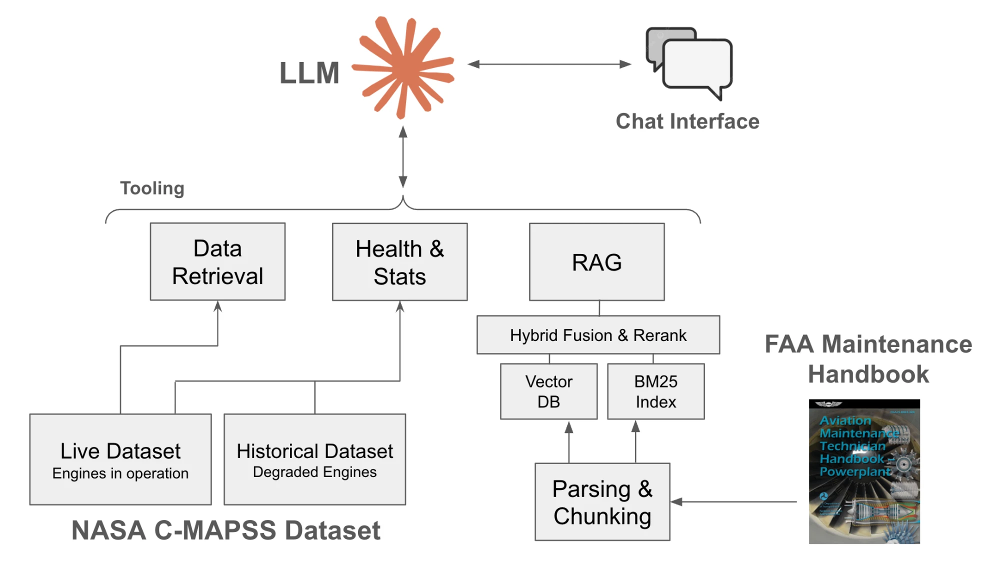

# industrial_agent

LLMs understand language remarkably well these days. What limits their
usefulness is rarely their understanding - it is their *context*. An agent
can't help you if it doesn't have the right information in front of it. This
is where tooling comes in.

A **tool** is a function the model is allowed to call. The model is given a
short description of each one; when a question arrives, it decides which
tools (if any) it needs, calls them, reads what comes back, and only then
answers. With access to several tools the model chooses when each is most
appropriate - often chaining them, e.g. ranking the fleet first and then
drilling into the worst engine.

This project demonstrates a typical setup: an agent acting as a helpful
assistant to an aircraft maintenance mechanic. Its tools let it **retrieve
engine wear data**, **compute health statistics** to judge degradation, and
**answer general maintenance questions from the FAA Powerplant Handbook**.
It is built on the raw Anthropic SDK - no LangChain or LlamaIndex - so every
step of the loop is visible.

```
question ──> Claude ──> tool_use? ──no──> answer
               ^                │
               │                yes
               └── tool results ─┘
```

**[Read the demo notebook](notebooks/demo.ipynb)** - saved with its cell
outputs. Each cell is one question, showing every tool call the model made
before it answered. [`demo_transcript.md`](demo_transcript.md) is the same
conversation as plain markdown.

## Data retrieval and statistics

The engine data is the NASA C-MAPSS turbofan degradation dataset (subset
FD001): a **live** set of 100 engines still in service, and a **historical**
set of 100 engines that were run to failure.

### Data retrieval

One of the most common kinds of tool is data retrieval. An LLM can't reach a
private database on its own, so a tool is built to query it and bring back
only the relevant information.

`get_current_readings` returns the latest sensor readings for one engine,
already set against the healthy norm:

```
Q: How is unit 76 doing?
  -> get_current_readings(unit=76)
     Unit 76, 205 cycles in service.
     Mean of last 10 cycles, with deviation from healthy norm:
       sensor_9: 9106.69  (healthy 9056.01, z=+6.1)
       sensor_14: 8177.95  (healthy 8137.37, z=+5.2)
       ...
```

### Health statistics

Another kind of tool calculates statistics. This keeps the numerical work
deterministic and predictable - computed in Python, the same way every time -
while the model does what it is good at: interpreting the result and making a
judgement.

| Tool | Answers |
|---|---|
| `assess_health` | How worn is this engine, on a scale that means something? |
| `rank_fleet` | Where should I look first? |

```
Q: Which engines need attention?
  -> rank_fleet(top_n=15, worst_first=true)
     100 engines in service. 10 at 70+ wear index (act now).
       unit  76: wear  86/100, 205 cycles in service
       unit  81: wear  80/100, 213 cycles in service
       ...
  -> assess_health(unit=76)
     Unit 76: close to failure, act now.
     Wear index 86/100.
     Largest deviations from healthy:
       sensor_9: 9106.69 vs healthy 9056.01 (z=+6.1)
       ...

Ten engines need attention now, and unit 76 is the one to pull first.
```

### Design notes

**Tools return interpreted results, not raw rows.** A model reasons better
over `sensor_11 is 3.2 sd above healthy` than over twenty floats.

**The wear index is calibrated, not invented.** Scoring is the mean absolute
z-score of an engine's last 10 cycles against a healthy norm - pooled from the
first 20 cycles of all 100 run-to-failure engines, which gives a stable noise
estimate. That raw statistic is then divided by the score those engines
reached *at failure* (3.77 sd, computed in `build_baseline`), so **100 means
"as worn as engines that failed"**. The calibration constant is never
surfaced: an engineer sees `wear index 86`.

**The index is not clamped at the bottom.** A new engine reads in the teens
rather than 0, because sensors are noisy and units vary at manufacture.
Clamping flattened a third of the healthy fleet to exactly zero and broke the
ranking.

**Seven of the 21 sensors are dropped.** Sensors 1, 5, 10, 16, 18 and 19 are
constant across FD001; sensor 6 is effectively binary (sd = 0.002), which makes
it useless as a signal and dangerous as a z-score denominator.

**Failures are data, not crashes.** A question about unit 250 gets
`No unit 250 in the fleet. Valid units are 1-100.` back as a tool result, so
the model can recover and say something useful. Unexpected exceptions come back
as `is_error` results rather than ending the turn.

## RAG over the maintenance handbook

Wouldn't it be great if the same agent could also answer maintenance
questions, grounded in the facts and guidance of an official manual?

The obvious approach - paste the manual into the prompt - doesn't scale. The
FAA Powerplant Handbook runs to 11 chapters and several hundred pages; feeding
all of it in on every question would overflow the context window, and be slow
and expensive even where it fit. The model needs a way to take in only the
most relevant material for each question. That is what **retrieval-augmented
generation (RAG)** does. Here it runs over a single handbook, but the same
process scales to much larger corpora - several manuals, or a folder of
Word documents.

RAG is a chain of steps whose job is to match a question to the few passages
of the manual that actually answer it, and leave the rest out. The model then
answers from that small, relevant selection - and cites where it came from.



### The pipeline

**Offline, once:**

1. **Parsing** - turns PDF pages, tables and figure captions into structured
   text blocks. The handbook is laid out in two columns, so blocks are put
   back in reading order, and tables are kept as tables (markdown) rather than
   flattened into a jumble of words.
2. **Chunking** - splits the text into passages of up to 300 words. A chunk
   never crosses a heading, and each one carries its chapter, section, page
   and engine type (turbine or reciprocating), so answers can be cited.
3. **BM25 index** - a keyword index that tracks exact terms in each chunk:
   specific jargon, part names and ID numbers ("EGT", "Figure 10-61") that a
   meaning-based search can blur.
4. **Vector database** - each chunk is embedded with
   [BGE](https://huggingface.co/BAAI/bge-small-en-v1.5), recording its
   semantic meaning, so "engine running hot" can find a passage about high
   exhaust gas temperature without sharing a word.

**Per question:**

5. **Turbine filter** - drops reciprocating-engine chunks when the question
   is about turbines (this fleet is turbofans).
6. **Hybrid fusion** - BM25 and the vector search each return their top 50;
   the two ranked lists are merged with reciprocal rank fusion.
7. **Rerank** - a cross-encoder reads the question and each of the top 20
   passages *together* and scores how well the passage answers it. This is
   slower but far more precise than either first-stage search.
8. **Confidence** - the best rerank score decides how to answer: below 0.15
   the agent refuses rather than guesses, below 0.40 it answers with caution.

A question the handbook covers, with the rerank score and citation for each
retrieved passage:

```
Q: Engine has high EGT at takeoff power. What should I check?
0.739  Ch. 10, p. 10-54  turbine  Engine Ratings
0.579  Ch. 10, p. 10-60  turbine  Turbine Engine Calibration & Testing
0.402  Ch. 10, p. 10-59  turbine  Turbine Engine Calibration & Testing
```

And one it doesn't - the handbook is general guidance, not a type-specific
manual, so the right answer is a refusal:

```
Q: What is the torque for the CFM56 fan blade bolts?
0.00  Ch. 10, p. 10-45  Turbine Engine Maintenance > Causes of Blade Damage
```

**Status:** parsing runs over all 11 chapters; the index currently holds
Chapter 10 (Engine Maintenance and Operation - 65 pages, 201
chunks). Retrieval is built and tested; wiring it into the agent as a
`search_maintenance_docs` tool is the next step, so one question can draw on
both the sensor tools and the handbook - e.g. *"Engine 34 shows HPC
degradation. What inspection applies, and how urgent is it?"*

## Layout

```
src/industrial_agent/
  data.py       download and load FD001; nothing is read at import time
  health.py     pure scoring - baseline, z-scores, wear index, verdict
  tools.py      the tools and their JSON schemas
  agent.py      the tool-use loop; yields events instead of printing
  chat.py       prints the exchange and saves a transcript
  plots.py      sensor traces, for context
  retrieval/
    parse.py    PDF -> blocks (text, headings, tables, captions)
    chunk.py    blocks -> cited chunks
    index.py    BGE embeddings + BM25, saved to data/index/
    search.py   filter, hybrid fusion, rerank, confidence bands
    app.py      Gradio page for trying and tuning search
scripts/        Colab entry points: download_corpus.py, build_index.py
eval/           hand-labelled queries.jsonl and run_eval.py (recall@k, ablations)
notebooks/
  demo.ipynb              the agent demo above
  rag_dev.ipynb           parsing and search, checked by eye
  rag_eval.ipynb          retrieval evaluation
  Industrial_Agent.ipynb  development scratchpad
tests/                    fixtures sliced from FD001; no network, no API key
```

## Running it

To run the demo notebook yourself you will need your own Anthropic API key -
add an `ANTHROPIC_API_KEY` secret.

The dataset (~4 MB) downloads on first use into a gitignored `data/`. The RAG
pipeline needs the `[rag]` extra (`pip install -e ".[rag]"`) and the handbook
chapter PDFs in `data/raw/`. Default model is `claude-opus-5`.

## Data

- [NASA C-MAPSS Turbofan Engine Degradation Simulation](https://data.nasa.gov/dataset/c-mapss-aircraft-engine-simulator-data),
  subset FD001, via
  [hankroark/Turbofan-Engine-Degradation](https://github.com/hankroark/Turbofan-Engine-Degradation).
  100 engines run to failure for calibration, 100 in service for the agent to
  reason about.
- FAA *Aviation Maintenance Technician Handbook - Powerplant*, one PDF per
  chapter from faa.gov.
